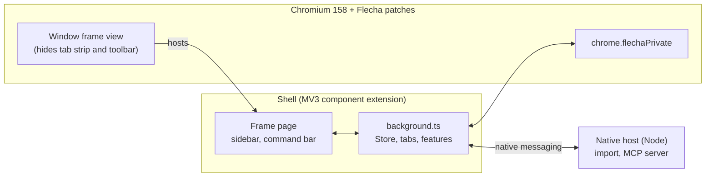

# Flecha

An Arc-style browser for developers, built on a Chromium fork. Arc's interface ideas are rebuilt from scratch; no Arc code is used.

<p align="center"></p>

## Why

Arc's vertical sidebar, Spaces and Peek are hard to give up, and Arc is no longer where the work is happening. Flecha is a replacement that keeps those ideas and adds tools for the people who build websites.

It is a Chromium 158 fork rather than an Electron app because Google blocks sign-in in Electron. Flecha is real Chromium, so Google sign-in, Chrome Web Store extensions and the rest of the web platform work as they do in Chrome. Flecha started as an Electron app; that version is gone from the repo (it's in the git history before the move to `chromium/`).

## Features

**Sidebar and tabs**
- A vertical sidebar with favourites, pinned tabs (with folders) and Today tabs, per Space
- Drag tabs between favourites, pinned, folders and Today
- Today tabs archive themselves after 12 hours by default (1 day, 7 days, 30 days or never in Settings); the archive is searchable
- Closing a pinned tab or favourite only unloads it and sends it back to its pinned URL
- Per-site favicons, tab muting, duplicate, copy link or Markdown link, copy screenshot
- On launch, the window comes back where it was

**Spaces**
- Spaces with their own colour and emoji; in dark mode the colour becomes a deep tint of the same hue
- Right-click a Space, then Separate Cookies and Logins, to be signed in as different users side by side (a persistent storage partition per Space)
- Switch with ⌃1 to ⌃9, or next and previous Space with ⌥⌘← and ⌥⌘→

**Command bar**

<p align="center"></p>

- ⌘T for a new tab, ⌘L for the current one; it searches open tabs, the archive and history
- Developer shortcuts: `gh owner/repo`, `gh 123` (in the current tab's repo), `npm react`, `mdn grid`, `caniuse :has`, `so ...`, and `env`
- Paste a JWT or a Unix timestamp to decode it in place
- Type `boost` to open the Boosts page

**Peek, split view and Flechinha**
- Peek: links that open a new tab from a pinned tab or favourite show in a floating preview; any link's right-click menu offers it too. Esc or a click outside closes it, Open turns it into a tab
- Split view: right-click a tab, Open in Split View, or ⌃⇧= to split with a new tab (⌃⇧- exits)
- Flechinha: a small standalone window for a quick page (⌥⌘N), which can be sent back into the main window

<p align="center"></p>

<p align="center"></p>

**Boosts**
- Per-site TypeScript and CSS (`github.com.ts`, `github.com.css`, `all.css`), kept in Flecha and edited on the Boosts page. CSS applies live; scripts reload the page. ⌥⌘B edits the current site's boost

**For developers**
- Console error badge: local tabs show how many console errors they have; clicking it opens the Console
- Responsive view (⌥⌘M): the page as a phone (393px, touch, mobile user agent) next to desktop
- Running locally: dev servers listening on this Mac show up in the sidebar, named after their project folder
- Environments: group a project's origins (local, staging, production) in Settings; ⌥⌘E moves the page to the next one with the same path, and the address bar shows a LOCAL, STAGING or PROD badge
- Chromium's DevTools (⌥⌘I), View source (⌥⌘U), zoom and Find in page
- Coding agents (MCP): Settings, Coding agents turns on a local MCP server (127.0.0.1, token required) so Claude Code, Cursor and others can list tabs, read pages and console logs, take screenshots, click, type and run JavaScript. Agents work in the background: their tabs open in an "Agent is working…" folder above Today, and nothing they do switches your tab or takes your keyboard. It needs the native host (see Install)

**Privacy and the rest of the browser**

<p align="center"></p>

- Built-in ad and tracker blocking (EasyList and EasyPrivacy as declarativeNetRequest rules, plus element hiding), toggled in Settings
- Incognito windows get the same Flecha frame, with one in-memory Space that is forgotten when the last incognito window closes
- Import bookmarks and history from other browsers, and Arc's Spaces with their colours, splits, favorites and archived tabs, with a preview and a choice to merge or add (needs the native host). What is read from Arc, and how sure we are of it: [docs/arc-import-format.md](docs/arc-import-format.md)
- Chrome extensions: install from the Chrome Web Store; their buttons appear under the address bar
- Light, dark or system theme; Flecha's shortcuts can be re-recorded in Settings (except a few Chromium keeps, like ⌘T and ⌘W) (⌘/ lists them)
- Settings (⌘,): search engine (Google, DuckDuckGo, Bing, Brave, Kagi, Ecosia), ad blocking, default browser, Peek behaviour, shortcuts, environments

Not there yet in the Chromium build: choosing the downloads folder from Settings, and the welcome tour.

## Install

1. Download the latest `Flecha-<version>.dmg` from [Releases](https://github.com/lucianodiisouza/flecha-browser/releases). Releases are signed with a Developer ID and notarized by Apple. They are **Apple Silicon (arm64) only** for now; Intel is planned.
2. Open the dmg and drag Flecha onto Applications.

<p align="center"></p>

3. Optional, but needed for importing from other browsers and Arc, and for the coding-agent MCP server:

```bash
git clone https://github.com/lucianodiisouza/flecha-browser.git && cd flecha-browser
chromium/scripts/install-native-host.sh --app /Applications/Flecha.app
```

Browsers can't read other browsers' files or open a local port, so Flecha ships a small native messaging host (a bundled Node, in the app). The script registers it with Chromium for Flecha's profile folder. It allows only Flecha's own shell extension to talk to it. Run it again if you move the app.

## Build from source

You need:

- macOS on Apple Silicon, with Xcode (and its command line tools)
- [depot_tools](https://commondatastorage.googleapis.com/chrome-infra-docs/flat/depot_tools/docs/html/depot_tools_tutorial.html) on your `PATH`
- a Chromium checkout at the version Flecha targets (158), with plenty of disk (100 GB or more) and several hours for a first build
- Node 22.5 or newer (the native host uses `node:sqlite`) and `npm ci` at the repo root

Fetching the Chromium checkout isn't scripted here; follow Chromium's [macOS build instructions](https://chromium.googlesource.com/chromium/src/+/main/docs/mac_build_instructions.md). Build on an APFS volume: `env.sh` expects the checkout on APFS because siso treats every output as stale on HFS+ (one-second file times) and rebuilds everything.

`chromium/scripts/env.sh` says where things live, and every script reads it. Override with `CHROMIUM_SRC` (the checkout's `src`), `DEPOT_TOOLS`, `FLECHA_DISK`, `FLECHA_VOLUME` and `FLECHA_PROFILE` (the dev profile). Its defaults assume a disk image that it mounts for you, so set these for your own layout.

### The dev loop

```bash
npm ci
chromium/scripts/build.sh              # apply.sh (branding and patches), then autoninja -C out/Dev chrome
chromium/scripts/run.sh                # launch out/Dev/Flecha.app with its own profile
node chromium/shell/build.mjs          # shell-only change: rebuild, then relaunch run.sh
npm run typecheck
```

`apply.sh` is safe to run again: it first resets every file it touches. The dev build is a component build, so a change relinks one small library. `run.sh` loads the shell from `chromium/shell/dist` through `--flecha-shell-dir`, so UI work needs no Chromium build at all (`npm run shell:watch` rebuilds on save).

### Pull request checks

CI tests the pull request's merge commit with locked npm dependencies. Node 24 runs both typecheckers and the tests. Node 26 bundles the shell and native host. The Ubuntu lint job checks workflows with pinned actionlint, runs ShellCheck and applies the patches to pinned Chromium. Windows also checks patch application. macOS probes the selected Xcode and SDK and exercises cleanup against test directories. Nightlies perform the physical runner cleanup. Every required job must succeed for `CI passed`.

### Release

#### Nightly builds on GitHub Actions

The `Nightly release` workflow starts daily at 02:00 UTC and also supports **Run workflow** on the default branch. GitHub can delay scheduled starts. Scheduled and manual runs share one concurrency group, so an active release finishes before another starts. GitHub keeps its default single pending run and replaces that pending run when a newer request arrives.

The workflow uses free standard runners for Linux x64, Windows x64 and Apple Silicon macOS. It builds the pinned `chromium/CHROMIUM_VERSION` with Flecha's patches and optimized, non-component release settings. Linux and Windows try a verified portable package before installing build tools or reclaiming disk space. A hit repackages the browser with the current shell and native host. A warm native tree can compile in stage zero. A cold tree checkpoints before compilation. macOS rebuilds and signs its app with the current build number. Checkpoints use zstd when available and can still restore older gzip archives. The five-hour stage allowance and ten-stage limit come from the [feasibility notes](docs/github-actions-chromium-feasibility-20261101.md). If a platform exhausts its stages, its last checkpoint remains available. A full build can span days.

After a platform uploads its package, a Linux monitor dispatches `Publish nightly platform` and waits for publication. The publisher checks the active monitor, the successful producing job, and the artifact's attempt-scoped name and immutable ID before downloading it. It verifies the checksums and source commit before adding files to the build's `nightly-<run-id>` prerelease. The first publisher creates the prerelease. Each platform uploads its `SHA256SUMS` file last and rechecks the monitor. If publication fails or is cancelled, cleanup removes assets owned by that publisher attempt. A platform is complete when its checksum file downloads and its checksums verify. Use **Re-run failed jobs** to retry a failed monitor with its successful build's original package. Rerunning the build itself produces a new artifact.

Linux gets `Flecha-linux-x64.tar.gz`, Windows gets `Flecha-windows-x64.zip`, and macOS gets `Flecha-macos-arm64.tar.gz` containing the ad hoc signed app. Nightlies are not notarized and do not use the stable Sparkle update feed. Packages include source provenance. Build inputs, packages and checkpoints remain available for 35 days, matching [GitHub's maximum workflow lifetime](https://docs.github.com/en/actions/reference/limits). The workflow deletes superseded checkpoints after a successful handoff and retains the final stage's input for retries. Published release assets remain available. Release tooling uses Node 26 LTS to avoid the Node 24 HTTP-parser crash during ad-block list downloads.

For Linux and Windows, extract the package into a writable directory, then run `flecha` or `Flecha.cmd`. The launcher keeps its profile beside the browser and registers the bundled native host. On Windows this writes the current user's Chromium native-host registry entry. Linux needs compatible system libraries and an OS configuration that permits Chromium's sandbox. On macOS, extract `Flecha.app`, copy it into Applications, and register its bundled host with `chromium/scripts/install-native-host.sh --app /Applications/Flecha.app` from the matching source checkout.

To start a build manually after the workflow is merged:

```bash
gh workflow run nightly-release.yml --repo Timpan4/flecha-browser --ref main
```

#### Signed macOS releases

```bash
export FLECHA_SIGN_IDENTITY="Developer ID Application: Your Name (TEAMID)"
export FLECHA_NOTARY_PROFILE=flecha-notary   # made once with: xcrun notarytool store-credentials
chromium/scripts/build-release.sh --dmg
```

`build-release.sh` builds the shell, applies the patches, stages the shell into the checkout, writes `out/Release/args.gn` from `chromium/build/release.gn`, builds (3 to 6 hours, resumable) and calls `package-release.sh`. That copies the app, adds the native host with its Node, signs everything innermost first (hardened runtime, timestamp and Chromium's entitlements when `FLECHA_SIGN_IDENTITY` is set; ad hoc otherwise), makes the dmg with an installer window, and with `FLECHA_NOTARY_PROFILE` notarizes it and staples the ticket. Releases use `target_cpu = "arm64"` and no proprietary codecs (H.264 and AAC), which need patent licences.

## Repo layout

```
chromium/
  patches/       the native changes to Chromium, as numbered unified diffs
  branding/      app icon, logo, BRANDING, the dmg background
  build/         dev.gn and release.gn (the GN args)
  scripts/       apply, build, run, env, build-release, package-release,
                 install-native-host, dmg-layout.py
  shell/         the MV3 component extension that draws the window
    background.ts   service worker: the Store, tabs, windows
    features/       ad blocking, boosts, console errors, local servers, responsive view
    ui/             sidebar, command bar, settings and Flechinha pages
    lib/            URLs, shortcuts, environments, settings rules, tab manager
  shared/        types and the sidebar model, used by the shell and the host
  native-host/   the native messaging host (Node)
```

## Architecture in brief

Flecha is Chromium plus two layers: a small set of patches, and an extension that draws the browser.



- **Patches** (`chromium/patches/`) change what only Chromium can: hide the tab strip and toolbar, draw Flecha's own window frame and traffic lights, round the page area, add Peek, Flechinha windows, split ratio, a storage partition per Space, and so on.
- **The shell** is a Manifest V3 extension loaded as a component extension, so it can't be removed or turned off. Its service worker (`background.ts`) owns the Store and the tabs; everything the user sees is shell HTML and TypeScript.
- **The frame page** is a shell page that Chromium's frame view hosts around the web contents. It draws the sidebar and command bar, and its drag regions move the window.
- **`chrome.flechaPrivate`** (`shell/flechaPrivate.d.ts`) is the private extension API the patches add, for what the standard APIs lack: frame state, shortcuts, theme, split ratio, Peek, Flechinha, partitions, DevTools, the find bar and default-browser. It is available to the shell only.
- **The native host** does what an extension can't: read other browsers' bookmarks and history, and serve MCP to coding agents on 127.0.0.1.

## Status and roadmap

Flecha is early software, used daily by its author. Next:

- Intel (x86_64) builds
- Auto-update with Sparkle (in progress)
- Resizable split divider and 3 to 4 pane splits
- Choosing the downloads folder and the welcome tour in the Chromium build

## Contributing

Bug reports and patches are welcome; see [CONTRIBUTING.md](CONTRIBUTING.md) for setup, how patches work, and the commit style.

## License

Flecha's own code is released under the [MIT license](LICENSE). Flecha is built on [Chromium](https://www.chromium.org/); Chromium and its third-party components keep their own BSD-style and other licenses, and those notices apply to the browser builds. Flecha is not affiliated with or endorsed by Google, Arc or The Browser Company.
